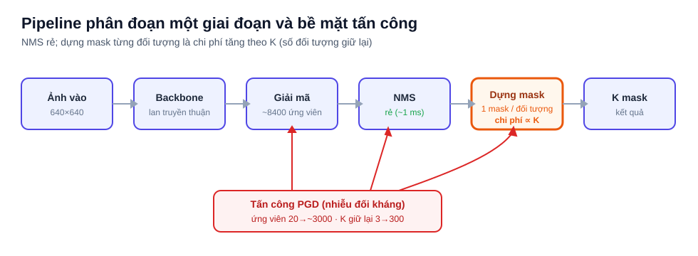
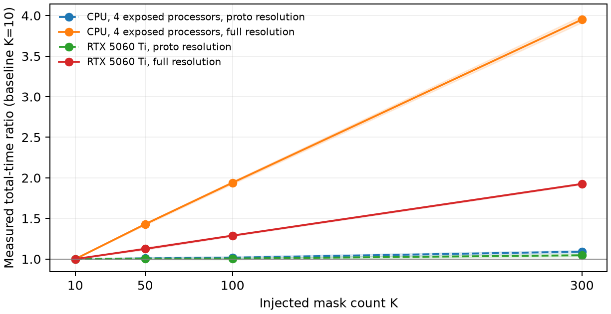
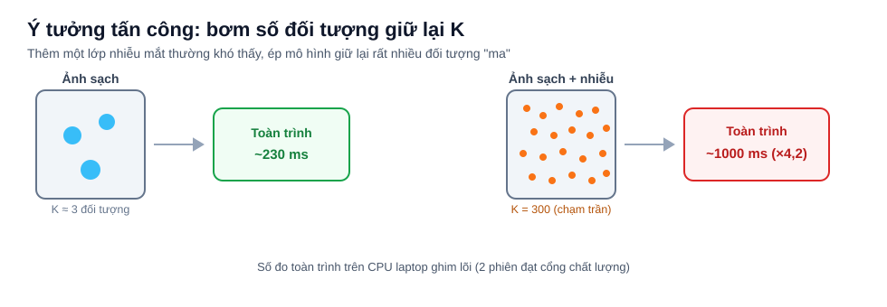
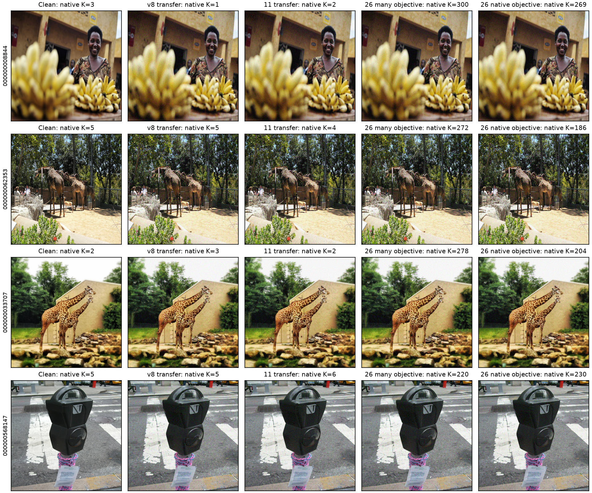
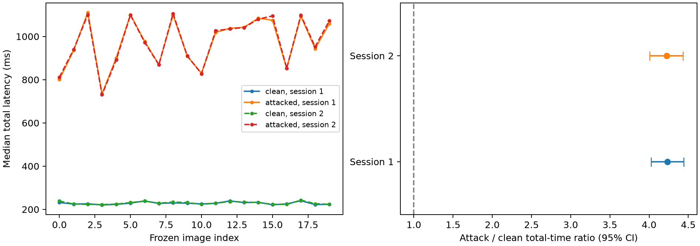
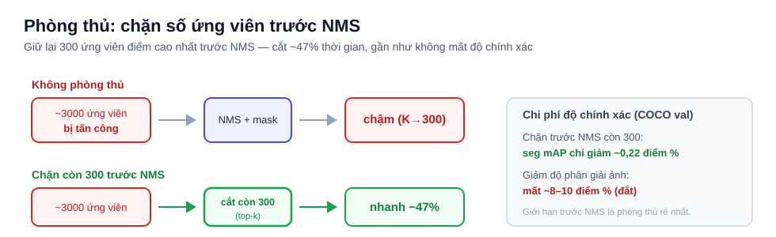
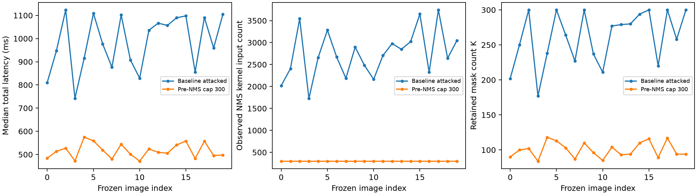
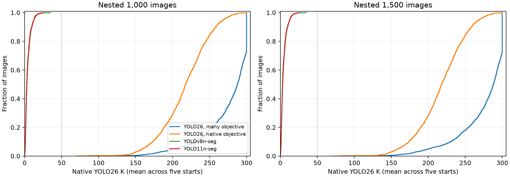

# Sponge Patch — tấn công cạn kiệt tài nguyên qua NMS và hậu xử lý mask

> Đề tài NCKH (HUTECH). Một tấn công đối kháng nhắm vào **tính sẵn sàng** của bộ phát hiện /
> phân đoạn đối tượng: không làm sai nhãn, mà **kéo dài thời gian xử lý mỗi khung hình** cho tới
> khi hệ thống thời gian thực lỡ hạn.

Mọi con số trong README đều truy được tới bản ghi thô (`file:selector`); thí nghiệm được **đăng ký
trước và gắn `git tag` trước khi đo**; kết quả âm được giữ nguyên, kèm hiệu ứng nhỏ nhất phát hiện
được (MDE).

---

## Mục lục
- [1. Câu hỏi nghiên cứu](#1-câu-hỏi-nghiên-cứu)
- [2. Cơ chế: tiền xử lý rẻ, dựng mask đắt](#2-cơ-chế-nms-rẻ-dựng-mask-đắt)
- [3. Tấn công: bơm số đối tượng giữ lại K](#3-tấn-công-bơm-số-đối-tượng-giữ-lại-k)
- [4. Kết quả đo lường](#4-kết-quả-đo-lường)
- [5. Phòng thủ](#5-phòng-thủ)
- [6. Chuyển giao sang model không dùng NMS](#6-chuyển-giao-sang-model-không-dùng-nms-yolo26-seg)
- [7. Phạm vi và giới hạn](#7-phạm-vi-và-giới-hạn)
- [8. Cấu trúc kho và tái lập](#8-cấu-trúc-kho-và-tái-lập)

---

## 1. Câu hỏi nghiên cứu

Các bộ phát hiện đối tượng dùng bước **loại bỏ không cực đại (NMS)** để bỏ các hộp chồng lấn. Một
dòng tấn công giả định: cứ tạo thật nhiều ứng viên trước NMS thì mô hình sẽ chậm đi. Đề tài này
**kiểm trực tiếp** giả định đó, và mở rộng sang model **phân đoạn** — nơi mỗi đối tượng giữ lại còn
phải được dựng một **mask** riêng.

> **Số lượng ứng viên trước NMS, hay số đối tượng giữ lại K, có thực sự dự đoán được độ trễ của bộ
> phát hiện không — và trong điều kiện nào (CPU một lõi, CPU nhiều lõi, GPU)?**

## 2. Cơ chế: NMS rẻ, dựng mask đắt



- Trên CPU một lõi, **lan truyền thuận chiếm phần lớn thời gian**, nên dù số ứng viên trước NMS tăng
  mạnh, NMS vẫn chỉ là một phần nhỏ — số ứng viên **không** là chỉ báo tốt cho độ trễ.
- Ngược lại, công đoạn **dựng mask cho từng đối tượng** tăng theo **K** (số đối tượng giữ lại sau
  NMS), nặng nhất khi mask ở độ phân giải đầy đủ (`retina_masks`).

Tỷ số thời gian toàn trình so với lúc K=10 (tiêm mask tổng hợp, đồng bộ CUDA khi đo GPU):

| Thiết bị | Mask full-res, K=300 | Mask proto-res, K=300 |
|---|---:|---:|
| CPU, 4 luồng | ~3,95× | ~1,09× |
| RTX 5060 Ti | ~1,93× | ~1,05× |



## 3. Tấn công: bơm số đối tượng giữ lại K



Một nhiễu đối kháng tối ưu bằng **PGD hộp trắng** đẩy số đối tượng giữ lại K từ ~3 lên tới trần
`max_det=300`. Trên **500 ảnh COCO val**, cả hai model đều đạt K=300 ở **500/500 ảnh**; mở rộng lên
**1.500 ảnh × 5 khởi tạo** (30.000 trường hợp) cho kết quả nhất quán.

Ví dụ ảnh bị tấn công (nhiễu toàn ảnh, mắt thường khó thấy):



## 4. Kết quả đo lường

Đo toàn trình thật trên CPU laptop một lõi ghim, 20 ảnh, so ảnh bị tấn công với ảnh sạch:

| Phiên | Đạt cổng chất lượng | Chậm hơn ảnh sạch [CI95%] |
|---|---|---:|
| 1 (carryover) | **Đạt** | **4,24× [4,03; 4,44]** |
| 2 (session_confirm) | **Đạt** | **4,22× [4,01; 4,43]** |

Ảnh sạch ~230 ms, ảnh bị tấn công ~750–1.100 ms. Hai phiên trượt cổng (do drift tham chiếu) vẫn cho
số gần như trùng (4,06–4,11×).



Số đo GPU riêng (YOLOv8n-seg, sàn nhiễu 0,28%): K=300 cho **2,04× [2,03; 2,04]** — hiệu ứng có trên
cả GPU, nhỏ hơn CPU vì lan truyền thuận nhanh hơn.

## 5. Phòng thủ



Giới hạn số ứng viên vào NMS còn 300 cắt khoảng **47%** thời gian trên ảnh bị tấn công
(**0,527× [0,507; 0,549]**), với chi phí độ chính xác rất nhỏ trên COCO val đầy đủ (seg mAP50–95 chỉ
giảm ~0,22 điểm %). Ngược lại, giảm độ phân giải ảnh làm mất ~8–10 điểm % mAP.



## 6. Chuyển giao sang model không dùng NMS (YOLO26-seg)

Nhiễu tối ưu trên YOLOv8/11-seg **không** chuyển giao sang YOLO26-seg (0/1.500 ảnh đạt K≥50). Nhưng
tối ưu **trực tiếp** trên YOLO26-seg vẫn đẩy được K (≥1.498/1.500 ảnh). Kết luận: kiến trúc không-NMS
**không miễn nhiễm** với tấn công tối ưu riêng cho nó — chỉ là nhiễu mang từ model khác sang thì không
hiệu quả.



## 7. Phạm vi và giới hạn

- **Testbed:** CPU laptop ghim lõi, CPU nhiều lõi, và một GPU RTX 5060 Ti. **Chưa** có board nhúng
  thật (Raspberry Pi) hay print-and-camera.
- **GPU timing trên môi trường thuê trượt cổng ổn định** (reference bị drift); chỉ mang tính chẩn
  đoán. Số CPU laptop đạt cổng là số chính.
- **Chi phí NMS phụ thuộc mạnh cách cài đặt:** cùng số ứng viên, hàm `non_max_suppression` của thư
  viện có thể chậm hơn nhân `torchvision` tới ~130 lần (cùng kết quả). Vì vậy con số "toàn trình chậm
  nhiều lần" do NMS được trình bày thận trọng.
- Đây là nghiên cứu **số đếm và đo thời gian** trong phạm vi đã nêu; **chưa** chứng minh một dịch vụ
  thật bị lỡ deadline (từ chối dịch vụ). "Không khác biệt" không được đọc là "tương đương".

## 8. Cấu trúc kho và tái lập

| Đường dẫn | Nội dung |
|---|---|
| `sponge-sim/src/` | Thư viện đo: ghim lõi, 4 backend NMS, thống kê, tiêm ứng viên |
| `sponge-sim/studies/` | Mã từng thí nghiệm (M0–M4, laptop_seg, validation_500, …) |
| `sponge-sim/prereg/` | Các bản đăng ký trước (PREREG) |
| `sponge-sim/results/` | Tóm tắt và manifest từng lần chạy (bản ghi thô lớn không kèm theo) |
| `sponge-sim/tests/` | Test hồi quy |
| `paper_en/` | Bản thảo tiếng Anh và bảng/hình sinh tự động |
| `core/`, `attack/`, `experiments/` | Mã gốc giai đoạn trước (đóng băng) |
| `figures/` | Hình kết quả và `figures/diagrams/` là sơ đồ minh hoạ |

```bash
cd sponge-sim
python -X utf8 -m pytest tests -q
```

Mọi phép đo thời gian cần máy rảnh, chế độ nguồn cố định, và chạy một mình (không làm việc khác song
song) để tránh drift tham chiếu.

## Nhóm và giấy phép

Đề tài NCKH tại HUTECH (nhóm: Phạm Tuấn Anh, Mai Quốc Bảo). Mã theo giấy phép [MIT](LICENSE); dữ liệu
và tài nguyên bên thứ ba giữ điều khoản riêng. Khi trích dẫn, ghi commit hoặc bản phát hành cụ thể.
